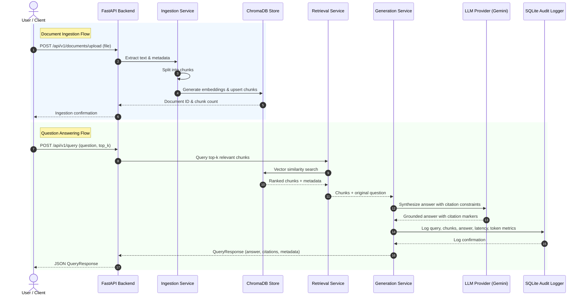

# DocuMind Specification (SPEC.md)

DocuMind is an open-source, production-grade Retrieval-Augmented Generation (RAG) system engineered for transparency, grounded answering, and rigorous evaluation.

---

## 1. Goals & Non-Goals

### 1.1 Goals
- **Strict Groundedness**: Every answer produced by DocuMind must be derived strictly from retrieved context chunks. When information is unavailable or insufficient, the system must explicitly state the limitation rather than hallucinate.
- **Precise Citation Tracking**: Answers must link claims directly to source metadata (document filename, page/section number, chunk index, and snippet).
- **Provider-Agnostic LLM Interface**: Decouple business logic from external LLM vendors via an abstract interface supporting Google Gemini (default free-tier) and alternative engines (e.g., Groq, local models).
- **Persistent & Scalable Local Storage**: Use persistent ChromaDB for vector embeddings and SQLite for comprehensive structured query/response auditing.
- **Production Readiness**: Provide end-to-end type safety (Pydantic v2), asynchronous API endpoints (FastAPI), comprehensive unit & integration test coverage (pytest), modern linting/formatting (Ruff), and containerization (Docker).
- **Continuous Evaluation**: Measure and report retrieval hit rate, faithfulness, latency, and query cost.

### 1.2 Non-Goals
- **General-Purpose Chatbot**: DocuMind is not an open-domain conversational assistant or creative writing tool.
- **Autonomous Multi-Step Agent**: DocuMind focuses on high-precision RAG question answering rather than multi-step tool execution, recursive task decomposition, or self-directed web browsing.
- **Proprietary Paid API Dependency**: DocuMind must remain runnable and reproducible entirely with free-tier or open-source local resources (BAAI/bge-small-en-v1.5 embeddings, local ChromaDB, free Google Gemini API tier).

---

## 2. User Stories

| ID | Persona | Action | Benefit |
|---|---|---|---|
| **US-01** | Knowledge Worker / Researcher | Upload PDFs, text files, and markdown documents through an API or Streamlit UI | Indexes knowledge base into persistent storage without manual database operations |
| **US-02** | Analyst / End User | Ask natural language questions over indexed documentation | Receives a concise, grounded answer with inline citations and excerpt previews |
| **US-03** | Compliance / Auditor | Inspect the SQLite audit log for past queries, retrieved context chunks, and generated answers | Verifies answer provenance and adherence to source documents |
| **US-04** | AI / Systems Engineer | Swap LLM providers (e.g., Gemini to Groq or local LLM) via configuration | Tests provider performance, latency, and cost without refactoring application code |
| **US-05** | ML / QA Engineer | Execute automated benchmark evaluations | Validates retrieval hit rate, faithfulness, and latency prior to production deployment |

---

## 3. Architecture & Pipeline

DocuMind is structured into six discrete, single-purpose stages:

```
[ Documents (PDF, MD, TXT) ]
            │
            ▼
┌──────────────────────────┐
│        1. Ingest         │  File validation, text extraction, metadata normalization
└───────────┬──────────────┘
            │
            ▼
┌──────────────────────────┐
│        2. Chunk          │  Recursive token/character splitting with sliding window overlap
└───────────┬──────────────┘
            │
            ▼
┌──────────────────────────┐
│        3. Embed          │  Local dense vector embeddings (BAAI/bge-small-en-v1.5)
└───────────┬──────────────┘
            │
            ▼
┌──────────────────────────┐
│        4. Store          │  ChromaDB persistent collection (vector + document metadata)
└───────────┬──────────────┘
            │
      [ User Query ]
            │
            ▼
┌──────────────────────────┐
│       5. Retrieve        │  Cosine similarity search, top-k ranking, threshold filtering
└───────────┬──────────────┘
            │
            ▼
┌──────────────────────────┐
│   6. Generate & Cite     │  Strict-context prompt synthesis via abstract LLM client
└───────────┬──────────────┘
            │
            ▼
[ Grounded Answer + Source Citations + SQLite Audit Log ]
```

### Stage Details
1. **Ingest (`src/documind/ingestion`)**: Parses incoming raw documents (PDF, TXT, Markdown), strips non-informative artifacts, extracts metadata (document hash, source path, page numbers), and validates payload integrity.
2. **Chunk (`src/documind/ingestion`)**: Decomposes clean text into manageable chunks using configurable chunk size and overlap (e.g., 500 characters with 50 character overlap), preserving section and document continuity.
3. **Embed (`src/documind/retrieval`)**: Generates 384-dimensional dense vector embeddings using `sentence-transformers` (`BAAI/bge-small-en-v1.5`) running locally on CPU.
4. **Store (`src/documind/retrieval`)**: Stores vectors, text snippets, and metadata in a persistent ChromaDB instance on disk (`./chroma_db`).
5. **Retrieve (`src/documind/retrieval`)**: Embeds incoming user queries and queries ChromaDB for the top-$k$ nearest neighbors with distance scores.
6. **Generate & Cite (`src/documind/generation` & `src/documind/llm`)**:
   - Constructs a structured prompt enforcing strict citation rules (`[1]`, `[2]`).
   - Dispatches prompt to the active LLM provider (Google Gemini API free tier) with automatic retry and exponential backoff.
   - Formulates the final payload with grounded text and linked citation objects.
   - Logs query, retrieved chunks, response, and latency to SQLite (`src/documind/logging`).

---

## 4. End-to-End Data Flow



---

## 5. API Endpoints

All endpoints are served under `/api/v1` (with standard OpenAPI docs at `/docs`).

### 5.1 Health & Diagnostics
- `GET /health`
  - **Purpose**: Liveness and readiness probe for Docker / orchestrator.
  - **Response**: `{"status": "ok", "version": "0.1.0", "environment": "development"}`

### 5.2 Document Management
- `POST /api/v1/documents/upload`
  - **Payload**: `multipart/form-data` containing document file (`.pdf`, `.txt`, `.md`).
  - **Response**:
    ```json
    {
      "document_id": "doc_8f12a4b",
      "filename": "q3_report.pdf",
      "chunks_indexed": 42,
      "status": "indexed"
    }
    ```
- `GET /api/v1/documents`
  - **Purpose**: Retrieve list of indexed documents and collection stats.
  - **Response**:
    ```json
    {
      "total_documents": 3,
      "total_chunks": 118,
      "documents": [
        {"document_id": "doc_8f12a4b", "filename": "q3_report.pdf", "chunk_count": 42}
      ]
    }
    ```
- `DELETE /api/v1/documents/{document_id}`
  - **Purpose**: Delete a document and its associated vectors from ChromaDB.

### 5.3 Query & Generation
- `POST /api/v1/query`
  - **Payload**:
    ```json
    {
      "query": "What was the revenue growth in Q3?",
      "top_k": 4
    }
    ```
  - **Response**:
    ```json
    {
      "query": "What was the revenue growth in Q3?",
      "answer": "Revenue increased by 14.2% year-over-year in Q3 [1].",
      "citations": [
        {
          "citation_index": 1,
          "document_id": "doc_8f12a4b",
          "filename": "q3_report.pdf",
          "chunk_id": "chunk_7",
          "page_number": 3,
          "snippet": "In the third quarter, total revenue reached $4.2M, representing a 14.2% year-over-year increase..."
        }
      ],
      "latency_seconds": 1.18,
      "model": "gemini-2.5-flash"
    }
    ```

### 5.4 Audit & Observability
- `GET /api/v1/logs`
  - **Parameters**: `limit: int = 50`, `offset: int = 0`
  - **Response**: Paginated list of past queries, responses, latencies, and error codes from SQLite.

---

## 6. Success Metrics & Target SLAs

| Metric | Target | Measurement Methodology |
|---|---|---|
| **Retrieval Hit Rate** | **$\ge 90\%$** | Evaluated on fixed Q&A benchmark test suite (percentage of queries where ground-truth chunk is present in retrieved top-$k$). |
| **Answer Faithfulness** | **$\ge 95\%$** | Evaluated with automated LLM-as-a-judge / RAGAS metric; percentage of claims directly entailed by retrieved context without external hallucination. |
| **p95 End-to-End Latency** | **$< 2.50\text{ s}$** | Measured over 100 benchmark queries under standard broadband conditions (including embedding, ChromaDB search, and LLM generation). |
| **Cost Per Query** | **$\$0.00$** | Maintained at zero cost by utilizing Google Gemini API free-tier quota combined with local open-source BGE embeddings and ChromaDB vector store. |
| **Test Coverage** | **$\ge 80\%$** | Unit and integration test coverage across config, ingestion, retrieval, generation, and API modules. |
